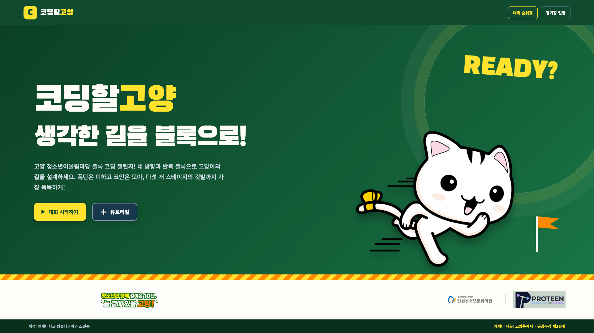
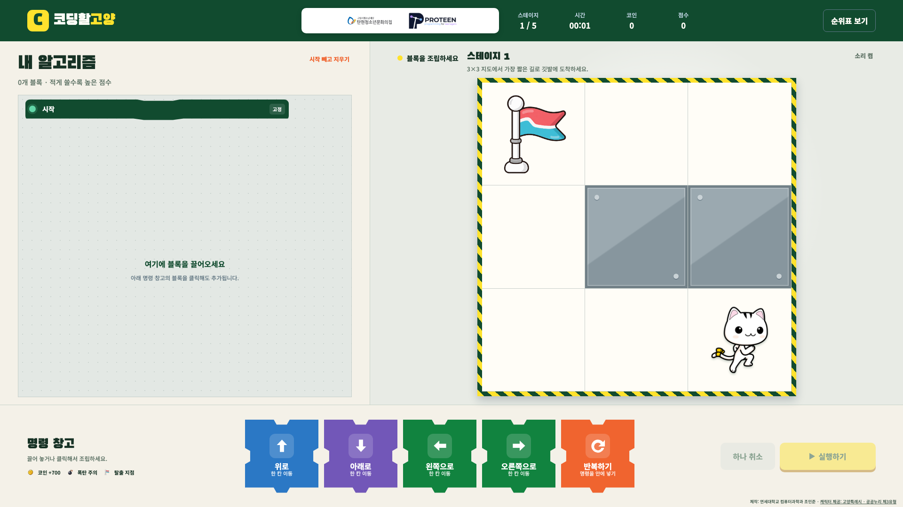
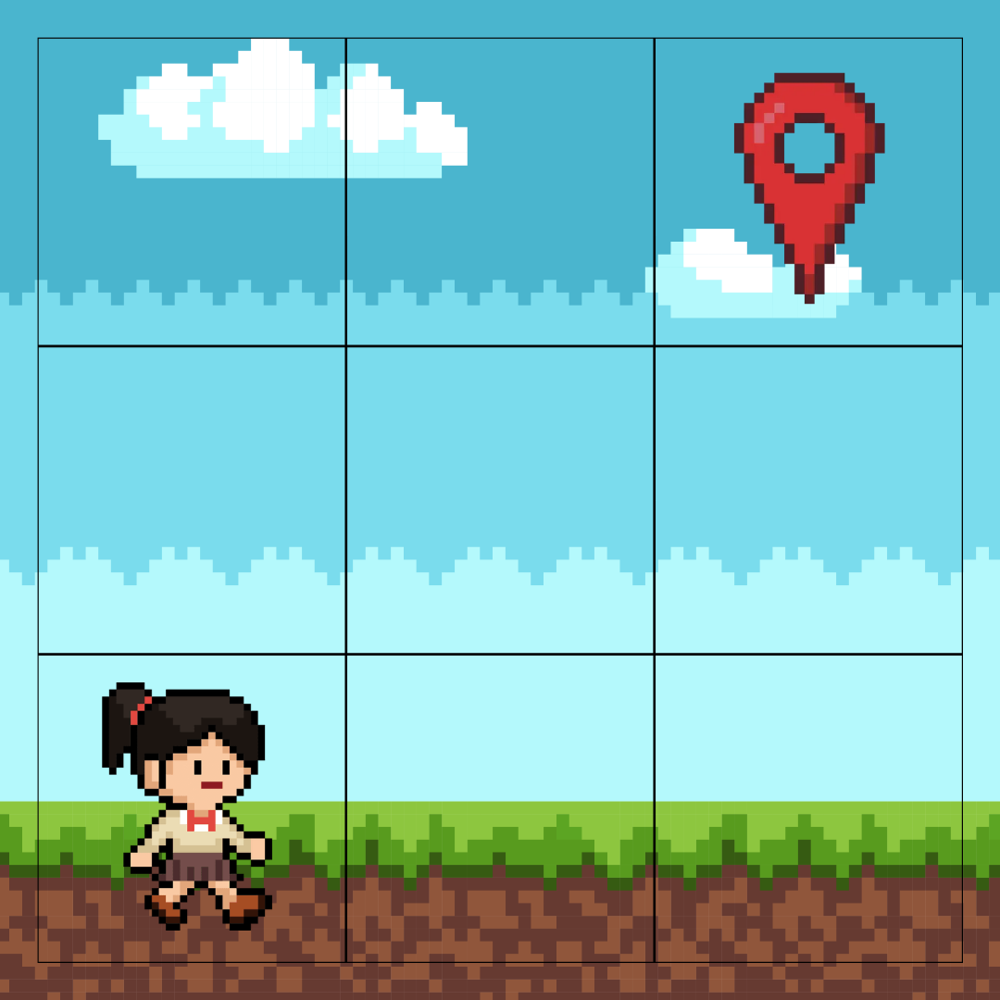
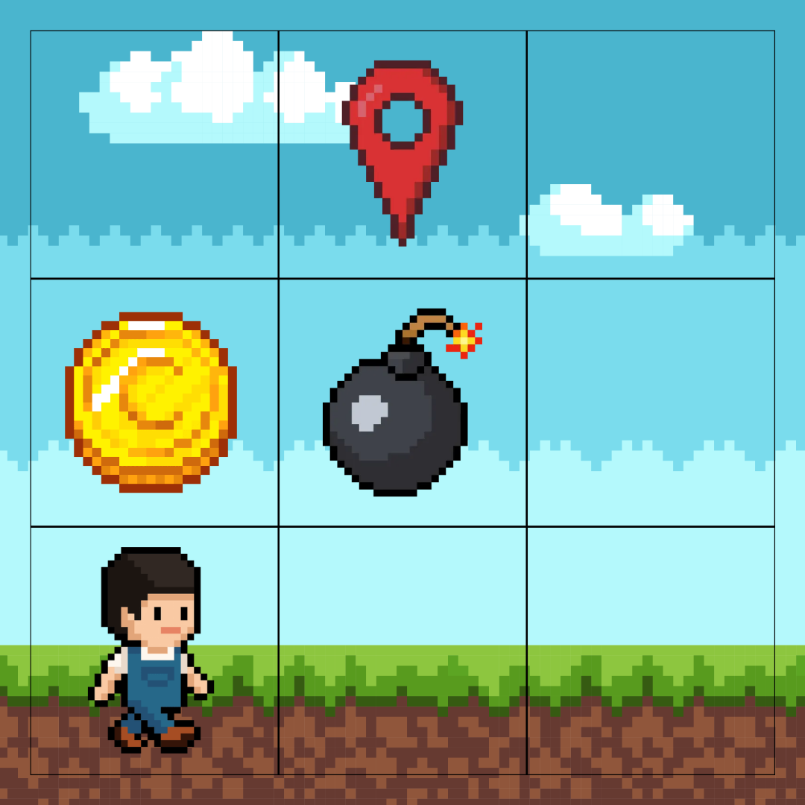
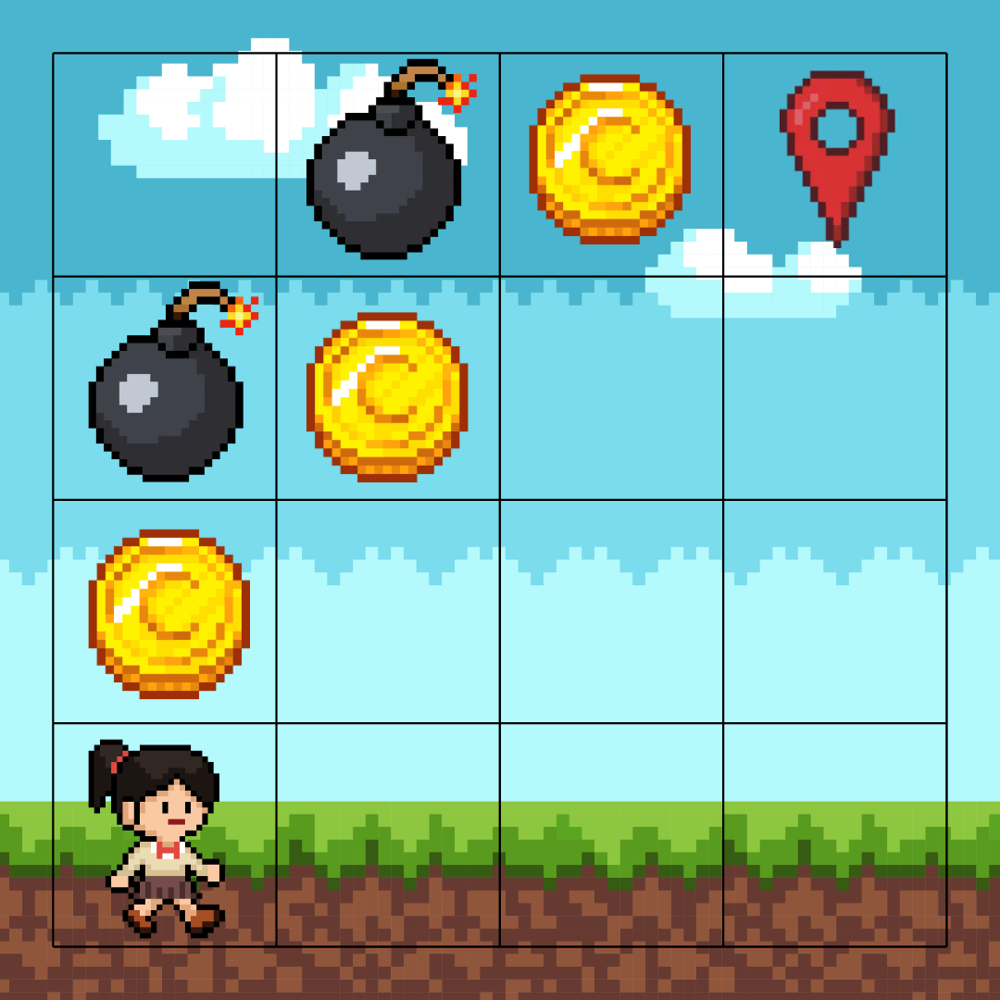
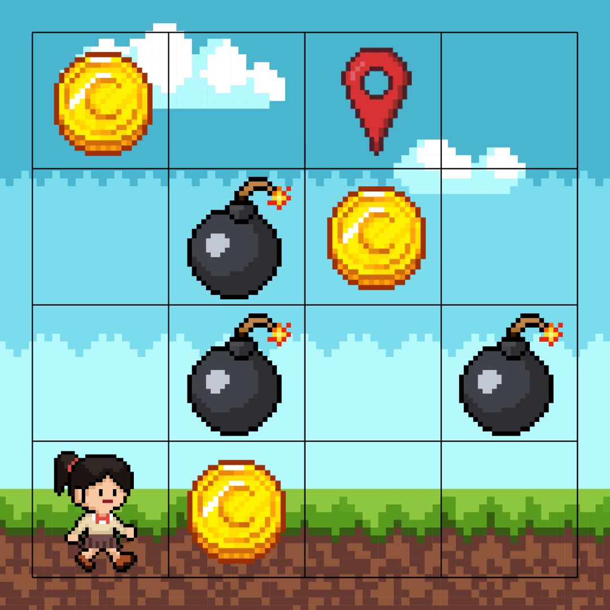
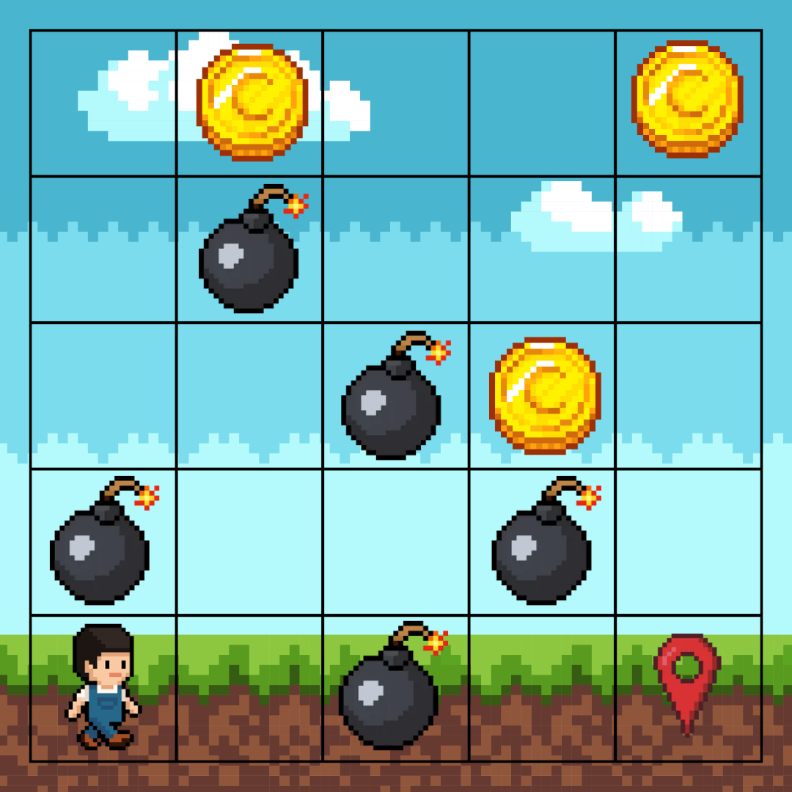

# 코딩할고양 프로젝트 전달사항

## 1. 프로젝트 목적

아이들이 블록 코딩으로 알고리즘을 구성해 폭탄을 피하고 코인을 모은 뒤 깃발로 탈출하는 5단계 웹게임입니다. 적은 블록과 빠른 완료 시간에 높은 점수를 주고, 코인에는 보너스 점수를 부여합니다. 5개 스테이지를 모두 끝낸 참가자만 이름을 입력해 순위표에 기록할 수 있습니다.

- 행사: 고양 청소년어울림마당
- 게임 이름: 코딩할고양
- 제작: 연세대학교 컴퓨터과학과 조민준
- 캐릭터 제공: 고양특례시 · 공공누리 제3유형(출처표시, 상업적 이용 가능, 변경금지)
- 이전 행사 버전은 GitHub의 `gmeta` 브랜치에 보존

## 2. 현재 구현 상태

- 메인 페이지와 경기 페이지 구현 완료
- 5개 스테이지 배치 구현 완료
- 고정된 `시작` 블록 구현 완료
- `위로`, `아래로`, `왼쪽으로`, `오른쪽으로`, `반복하기` 명령만 제공
- 명령 블록 클릭 추가 및 드래그 앤 드롭 지원
- 명령 순서 변경과 반복 블록 내부 삽입 지원
- ㄷ자 반복 블록과 2~6회 반복 횟수 조절 지원
- 스테이지별 블록 개수 제한 없이 자유롭게 조립 가능
- 실제 실행 전 경로 미표시
- 폭탄·벽 충돌, 코인 획득, 깃발 도착 판정 구현
- 서버 재검증 기반 채점과 순위표 등록 구현
- 1920×1080 경기 화면 및 반응형 화면 대응
- 명령 블록과 지도 칸을 정사각형으로 고정

## 3. 화면 구성

경기 화면은 1920×1080을 기준으로 다음과 같이 구성했습니다.

- 상단: 현재 스테이지, 시간, 코인, 점수, 순위표
- 왼쪽: 참가자가 블록을 조립하는 알고리즘 영역
- 오른쪽: 정사각형 셀로 구성된 게임 지도
- 하단: 정사각형 명령 블록 5종과 실행 버튼

### 최종 메인 화면



### 최종 경기 화면



## 4. 스테이지 규칙

| 스테이지 | 지도 | 최소 블록 도전 | 주요 구성 |
|---|---:|---:|---|
| 1 | 3×3 | 4 | 이동 학습 |
| 2 | 3×3 | 5 | 코인 2개, 폭탄 1개 |
| 3 | 5×5 | 4 | 코인 3개, 폭탄 2개 |
| 4 | 5×5 | 5 | 코인 3개, 폭탄 3개 |
| 5 | 7×7 | 7 | 코인 4개, 폭탄 5개 |

배치는 [`public/stages.js`](public/stages.js)에서 수정합니다. 좌표는 `[행, 열]`이며 0부터 시작합니다.

### 5단계 배치 예외

전달받은 5단계 원본은 시작점 바로 위와 오른쪽이 폭탄으로 막혀 탈출할 수 없었습니다. 게임 진행이 가능하도록 시작점 바로 위 폭탄 한 개를 제외했습니다. 원본 이미지는 보존되어 있으므로 최종 운영 규칙에 따라 배치를 다시 결정할 수 있습니다.

## 5. 점수와 순위표

스테이지 점수는 서버의 다음 규칙으로 계산합니다.

```text
max(500, round(5000 - 경과시간(ms) / 25 - 사용 블록 수 × 45 + 획득 코인 수 × 700))
```

- 점수 계산 및 명령 검증: [`server.mjs`](server.mjs)
- 순위 데이터: [`data/scores.json`](data/scores.json)
- 순위는 점수 내림차순, 동점이면 완료 시간 오름차순
- 화면에는 상위 20명, 파일에는 최대 100명을 저장
- 현재 파일에는 기능 확인용 기록 1개가 들어 있습니다.
- 대회 시작 전 `data/scores.json`의 내용을 `[]`로 바꾸면 순위표가 초기화됩니다.

현재 순위표는 한 서버의 로컬 JSON 파일에 저장됩니다. 여러 서버 인스턴스에서 동시에 운영하거나 외부 공개 서비스로 배포하려면 데이터베이스와 동시 쓰기 처리가 추가로 필요합니다.

## 6. 실행과 검사

Node.js 20 이상에서 별도 패키지 설치 없이 실행할 수 있습니다.

```bash
npm start
```

- 메인 페이지: `http://localhost:4173`
- 경기 페이지: `http://localhost:4173/game.html`
- 포트를 바꾸려면 `PORT` 환경 변수를 지정합니다.

문법 검사는 다음 명령으로 실행합니다.

```bash
npm run check
```

## 7. 주요 파일

- [`public/index.html`](public/index.html): 메인 페이지
- [`public/game.html`](public/game.html): 경기 화면
- [`public/app.js`](public/app.js): 블록 편집, 실행, 게임 상태
- [`public/stages.js`](public/stages.js): 5개 스테이지 데이터
- [`public/styles.css`](public/styles.css): 경기 화면과 게임 오브젝트 스타일
- [`public/home.css`](public/home.css): 메인 페이지 스타일
- [`server.mjs`](server.mjs): 정적 서버, 채점 검증, 순위표 API
- [`DESIGN.md`](DESIGN.md): 디자인 시스템
- [`PRODUCT.md`](PRODUCT.md): 제품 방향과 사용자 정의

## 8. 전달 이미지

모든 원본과 참고 이미지는 실행용 에셋과 분리해 `docs/images` 아래에 보관했습니다.

- `docs/images/reference/character-originals/`: 이전 행사에서 전달받은 캐릭터 원본 18장(보존용)
- `docs/images/reference/stages/`: 전달받은 스테이지 원본 5장
- `docs/images/reference/feedback/`: 명령 블록 및 지도 정사각형 수정 요청 캡처 2장
- `docs/images/previews/`: 현재 메인·경기 화면 1920×1080 캡처
- `public/assets/branding/`: 행사 문구, 탄현청소년문화의집, PROTEEN 로고
- `public/assets/goyang-cat-*.png`: 실제 게임에서 사용하는 고양특례시 공식 캐릭터 원본

### 스테이지 원본

| 1 | 2 | 3 | 4 | 5 |
|---|---|---|---|---|
|  |  |  |  |  |

이미지의 사용·배포 권한은 행사 운영 주체가 최종 확인해야 합니다.

## 9. 운영 전 최종 확인 항목

1. 최종 스테이지 배치 확정
2. 점수 공식과 코인 보너스 확정
3. `data/scores.json` 초기화
4. 행사 PC의 1920×1080 화면에서 브라우저 100% 배율 확인
5. 참가자 수에 따라 단일 로컬 서버 또는 데이터베이스 방식 결정
6. 행사 네트워크에서 접속 주소와 방화벽 확인
7. 고양특례시 캐릭터의 공공누리 제3유형 출처표시와 변경금지 조건 유지
